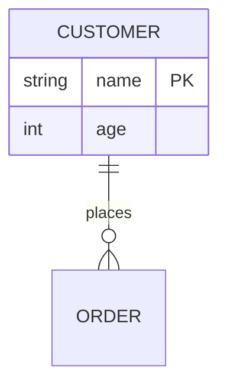

# mermaid-edit.nvim

[](https://github.com/porteightyeighty/mermaid-edit.nvim/actions/workflows/test.yml)

A Neovim plugin for editing the structure of [Mermaid](https://mermaid.js.org/) flowcharts and ER
diagrams. It uses the tree-sitter parse tree to insert, swap, reshape and remove steps in a
flowchart, and to change relationships, attributes and entity names in an ER diagram.

<!-- demo video -->

## Why

In a flowchart, the connections between steps are node IDs repeated across lines:


To insert a step between `login` and `browse`, or swap two steps, you have to rewrite those IDs by
hand without breaking the chain. This plugin does that for you.

## Requirements

- Neovim 0.10 or later
- The `mermaid` tree-sitter parser, for example `:TSInstall mermaid` with
  [nvim-treesitter](https://github.com/nvim-treesitter/nvim-treesitter)

`:checkhealth mermaid-edit` checks both.

## Install

With [lazy.nvim](https://github.com/folke/lazy.nvim):

```lua
{
  "porteightyeighty/mermaid-edit.nvim",
  ft = "mermaid",
  opts = {},
}
```

## Usage

Each key works in both kinds of diagram. The plugin checks which kind the cursor is in.

| Key          | Command              | Flowchart                               | ER diagram                         |
|--------------|----------------------|-----------------------------------------|------------------------------------|
| `<leader>mi` | `:MermaidInsertStep` | Insert a step between two nodes         | Add an attribute                   |
| `<leader>mo` | `:MermaidAddStep`    | Add a step after a node                 | Add a relationship                 |
| `<leader>mj` | `:MermaidSwapDown`   | Swap a step with the next one           | Move an attribute down             |
| `<leader>mk` | `:MermaidSwapUp`     | Swap a step with the previous one       | Move an attribute up               |
| `<leader>ms` | `:MermaidShape`      | Change a node's shape                   | Set an attribute's key (PK/FK)     |
| `<leader>ma` | `:MermaidArrow`      | Change an edge's arrow                  | Change a relationship's cardinality |
| `<leader>ml` | `:MermaidLabel`      | Add, change or remove an edge label     | Change a relationship's role       |
| `<leader>md` | `:MermaidRemove`     | Remove a node and reconnect its neighbours | Remove an attribute or relationship |
| `<leader>mr` | `:MermaidRename`     |                                         | Rename an entity everywhere        |
|              | `:MermaidAttrType`   |                                         | Change an attribute's type         |

### Flowcharts

Put the cursor on an edge line, such as `login --> browse[Browse jobs]`.

- **Insert** asks for a label, makes a snake_case ID from it, and gives the new node the same
  shape as the edge's target.
- **Add step** adds a node after the one under the cursor. If that node already has a next step,
  the new one starts a separate branch.
- **Swap** exchanges two adjacent steps by swapping their IDs across the whole diagram, so every
  edge into or out of either node still connects. Each node keeps its label.
- **Shape** wraps the label in the shape you pick and leaves the text unchanged.
- **Arrow** changes the edge's style (`-->`, `---`, `-.->`, `==>`, `--o`, `--x`, `<-->` and so on)
  and keeps its label.
- **Label** adds or changes the edge's label (`A -->|label| B`). An empty label removes it.
- **Remove** deletes the node under the cursor and connects each node before it to each node after
  it, so `P --> X --> Q` becomes `P --> Q`.

These also work on chained lines (`A --> B --> C`). Insert, swap, shape and remove work on `&`
groups (`A --> B & C`) too.

### ER diagrams

Put the cursor on a relationship line, such as `CUSTOMER ||--o{ ORDER : places`, or inside an
entity's attribute block.



- **Cardinality** asks for the left side, the line type (`--` identifying, `..` non-identifying)
  and the right side, each starting from the current value.
- **Role** changes the relationship's label. A role with spaces is quoted for you. Mermaid requires
  a role, so an empty one is refused.
- **Key** sets or clears `PK` or `FK` on the attribute under the cursor.
- **Add attribute** asks for a type and a name and adds them to the block.
- **Add relationship** asks for two entities and a role.
- **Move** reorders an attribute within its block.
- **Remove** deletes the attribute or relationship under the cursor.
- **Rename** renames the entity in every relationship and in its attribute block. Only exact names
  match, so renaming `ORDER` leaves `ORDER_LINE` alone.

## Configuration

These are the defaults:

```lua
require("mermaid-edit").setup({
  keymaps = {
    insert_step   = "<leader>mi",
    add_step      = "<leader>mo",
    swap_down     = "<leader>mj",
    swap_up       = "<leader>mk",
    change_shape  = "<leader>ms",
    change_arrow  = "<leader>ma",
    edit_label    = "<leader>ml",
    remove_node   = "<leader>md",
    rename_entity = "<leader>mr",
  },
  default_shape     = "square",  -- shape for a new node when the edge's target has no label
  default_relation  = "||--o{",  -- marker for a new ER relationship
  default_attr_type = "string",  -- type suggested for a new ER attribute
})
```

The keys are set only in `mermaid` buffers. The `:Mermaid*` commands work whatever the keymaps are.

### Changing the keys

- To change or turn off one key, set it in `keymaps`. Set it to `false` to turn it off, or set
  `keymaps = false` to turn them all off.
- To map keys yourself, turn the defaults off and map the `<Plug>` handles below, for example in
  `after/ftplugin/mermaid.lua`:

  ```lua
  vim.keymap.set("n", "<leader>I", "<Plug>(mermaid-insert-step)", { buffer = true })
  ```

- A key you have already mapped in a mermaid buffer is never overwritten, so you can also just map
  over a default.

| Handle                        | Action                                   |
|-------------------------------|------------------------------------------|
| `<Plug>(mermaid-insert-step)` | insert a step / add an attribute         |
| `<Plug>(mermaid-add-step)`    | add a step / add a relationship          |
| `<Plug>(mermaid-swap-down)`   | swap down / move an attribute down       |
| `<Plug>(mermaid-swap-up)`     | swap up / move an attribute up           |
| `<Plug>(mermaid-shape)`       | change a shape / set a key               |
| `<Plug>(mermaid-arrow)`       | change an arrow / change cardinality     |
| `<Plug>(mermaid-label)`       | change an edge label / change a role     |
| `<Plug>(mermaid-remove)`      | remove a node, attribute or relationship |
| `<Plug>(mermaid-rename)`      | rename an entity                         |
| `<Plug>(mermaid-attr-type)`   | change an attribute's type               |

## Limitations

- Subgraphs and ER aliases (`CUSTOMER["Customer record"]`) aren't supported.
- The plugin won't edit a diagram that has parse errors. A few things Mermaid accepts are errors in
  the tree-sitter grammar:
  - `<br/>` clashes with shapes that end in `/]`. Use `<br>`, which renders the same.
  - The dotted open link `-.-` doesn't parse, so the arrow picker leaves it out. Use `-.->`.
  - In ER diagrams, every relationship needs a role and each attribute needs its own line.
  - Only `PK` and `FK` keys parse. `UK` and `PK, FK` don't, so the key picker leaves them out.

## Development

The tests run headless against this checkout and need the `mermaid` parser. `make parser` builds it
without nvim-treesitter.

```sh
make test
```

`demo/demo.tape` records the demo with [vhs](https://github.com/charmbracelet/vhs):
`vhs demo/demo.tape`.

## License

MIT
