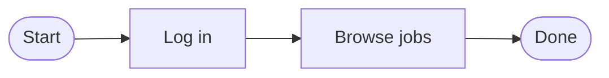

# mermaid-edit.nvim

Treesitter-assisted structural edits for [mermaid](https://mermaid.js.org/)
flowcharts in Neovim. Insert a step between two nodes, swap adjacent steps, and
change a node's shape - without hand-rewriting the shared node ids that hold a
linear chart together.

Other mermaid plugins render, preview, or lint. This one *edits structure*.

## Why

In a flowchart the connectivity lives in node ids shared across adjacent lines:



Inserting a step between `login` and `browse`, or swapping two steps, means
rewriting those ids by hand so the chain doesn't break. `mermaid-edit` does it
from the parse tree.

## Requirements

- Neovim 0.10+
- The `mermaid` tree-sitter parser (e.g. `:TSInstall mermaid` via
  [nvim-treesitter](https://github.com/nvim-treesitter/nvim-treesitter))

Run `:checkhealth mermaid-edit` to verify.

## Install

With [lazy.nvim](https://github.com/folke/lazy.nvim):

```lua
{
  "matthewport/mermaid-edit.nvim",
  ft = "mermaid",
  opts = {},
}
```

Developing locally? Point lazy at the checkout:

```lua
{ dir = "~/dev/mermaid-edit.nvim", ft = "mermaid", opts = {} }
```

## Usage

Put the cursor on an edge line (`SRC --> TGT[label]`) and:

| Default map   | Command              | Action                                        |
|---------------|----------------------|-----------------------------------------------|
| `<leader>mi`  | `:MermaidInsertStep` | Insert a new step between the two nodes        |
| `<leader>mj`  | `:MermaidSwapDown`   | Swap this step with the next one               |
| `<leader>mk`  | `:MermaidSwapUp`     | Swap this step with the previous one           |
| `<leader>ms`  | `:MermaidShape`      | Change the shape of the node under the cursor  |
| `<leader>md`  | `:MermaidRemove`     | Remove the node under the cursor, bridge the gap |

- **Insert** prompts for a label, derives a unique snake_case id, and gives the
  new node the same shape as the edge's target.
- **Swap** trades the positions of two adjacent steps by transposing their ids
  across the whole diagram, so every edge into or out of either node follows it
  and the chain stays connected - including fan-in and fan-out. Each node keeps
  its own label.
- **Change shape** rewraps the label in a shape you pick, leaving the label text
  (including `<br>`) untouched.
- **Remove** deletes the node under the cursor and bridges the gap: each
  predecessor is reconnected to each successor (`P --> X --> Q` becomes
  `P --> Q`), so the chain stays connected. On a one-liner or `&` branch the
  node is spliced out in place.

## Configuration

```lua
require("mermaid-edit").setup({
  keymaps = {                  -- buffer-local; set an entry or the table to false to disable
    insert_step  = "<leader>mi",
    swap_down    = "<leader>mj",
    swap_up      = "<leader>mk",
    change_shape = "<leader>ms",
    remove_node  = "<leader>md",
  },
  default_shape = "square",     -- shape for a new node when the edge target is a bare id
})
```

The `:Mermaid*` commands always work regardless of keymaps.

## Limitations

- **All flowchart connectivity styles** are handled: one edge per line
  (`SRC <arrow> TGT[label]`, threaded through shared ids), chained one-liners
  (`A --> B --> C`, ordered positionally), and `&` branching - both fan-out
  (`A --> B & C`) and fan-in (`A & B --> C`). Multi-line branches (a node with
  several incoming or outgoing edges) stay connected through a swap because the
  whole diagram is re-threaded by id, and the connecting edge is found by id
  rather than by line adjacency. On a one-liner or `&` line, swap reorders in
  place (an `&` sibling, else the adjacent group) and insert splices a node into
  the transition under the cursor. Reshaping reaches any vertex, including one
  inside an `&` group. **Subgraphs** remain out of scope.
- **Write parseable mermaid.** Use `<br>`, not `<br/>` - the self-closing slash
  makes the grammar error (it collides with slanted-shape closers like `/]`),
  and `mermaid-edit` refuses to edit a tree with errors. `<br>` renders
  identically.

## License

MIT
