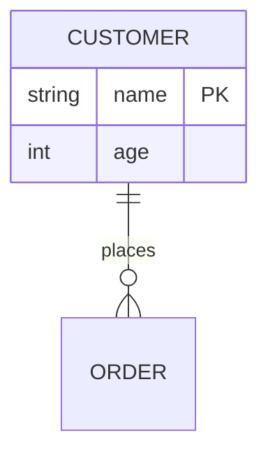

# mermaid-edit.nvim

Treesitter-assisted structural edits for [mermaid](https://mermaid.js.org/)
**flowcharts** and **erDiagrams** in Neovim. On a flowchart: insert a step
between two nodes, swap adjacent steps, change a node's shape, restyle an edge,
and label edges - without hand-rewriting the shared node ids that hold a linear
chart together. On an erDiagram: change a relationship's cardinality, edit its
role, manage an entity's attributes, and rename an entity across every line at
once.

Other mermaid plugins render, preview, or lint. This one *edits structure*. The
same keymaps work on both diagram kinds: each action detects whether the cursor
is in a flowchart or an erDiagram and does the right thing.

## Why

In a flowchart the connectivity lives in node ids shared across adjacent lines:


Inserting a step between `login` and `browse`, or swapping two steps, means
rewriting those ids by hand so the chain doesn't break. `mermaid-edit` does it
from the parse tree.

## Requirements

- Neovim 0.10+
- The `mermaid` tree-sitter parser (e.g. `:TSInstall mermaid` via
  [nvim-treesitter](https://github.com/nvim-treesitter/nvim-treesitter))

Run `:checkhealth mermaid-edit` to verify.

## Install

With [lazy.nvim](https://github.com/folke/lazy.nvim):

```lua
{
  "porteightyeighty/mermaid-edit.nvim",
  ft = "mermaid",
  opts = {},
}
```

## Usage

Each keymap carries a flowchart meaning and an erDiagram meaning; the action
detects the diagram kind under the cursor and routes accordingly.

| Default map   | Command              | Flowchart action                              | erDiagram action                          |
|---------------|----------------------|-----------------------------------------------|-------------------------------------------|
| `<leader>mi`  | `:MermaidInsertStep` | Insert a new step between the two nodes        | Add an attribute to the entity block       |
| `<leader>mo`  | `:MermaidAddStep`    | Add a step after the node (a new branch)       | Add a relationship line                     |
| `<leader>mj`  | `:MermaidSwapDown`   | Swap this step with the next one               | Move the attribute down within its block    |
| `<leader>mk`  | `:MermaidSwapUp`     | Swap this step with the previous one           | Move the attribute up within its block      |
| `<leader>ms`  | `:MermaidShape`      | Change the shape of the node                   | Change the attribute key (none/PK/FK)       |
| `<leader>ma`  | `:MermaidArrow`      | Change the edge's arrow style                  | Change the relationship's cardinality       |
| `<leader>ml`  | `:MermaidLabel`      | Add, edit, or remove the edge's label          | Edit the relationship's role                |
| `<leader>md`  | `:MermaidRemove`     | Remove the node, bridge the gap                | Remove the attribute or relationship        |
| `<leader>mr`  | `:MermaidRename`     | -                                              | Rename the entity everywhere it appears     |
| -             | `:MermaidAttrType`   | -                                              | Change the attribute's type                 |

### Flowcharts

Put the cursor on an edge line (`SRC --> TGT[label]`).

- **Insert** prompts for a label, derives a unique snake_case id, and gives the
  new node the same shape as the edge's target.
- **Add step** appends a new node after the node under the cursor as a fresh
  outgoing edge. On a terminal node it extends the chain; on a node that already
  has a successor it forks off a new branch that does not auto-connect to
  anything downstream. The arrow reuses the node's incoming style.
- **Swap** trades the positions of two adjacent steps by transposing their ids
  across the whole diagram, so every edge into or out of either node follows it
  and the chain stays connected - including fan-in and fan-out. Each node keeps
  its own label.
- **Change shape** rewraps the label in a shape you pick, leaving the label text
  (including `<br>`) untouched.
- **Change arrow** restyles the edge under the cursor (`-->`, `---`, `-.->`,
  `==>`, `--o`, `--x`, `<-->`, ...) from a picker, keeping any edge label.
- **Edit label** adds or changes the edge's label (`A -->|label| B`); submitting
  an empty label removes it. A `-- label -->` mid-edge label is normalised to the
  `|label|` form. On a chained one-liner both arrow and label operations act on
  the transition under the cursor.
- **Remove** deletes the node under the cursor and bridges the gap: each
  predecessor is reconnected to each successor (`P --> X --> Q` becomes
  `P --> Q`), so the chain stays connected. On a one-liner or `&` branch the
  node is spliced out in place.

### erDiagrams

Put the cursor on a relationship line (`CUSTOMER ||--o{ ORDER : places`) or
inside an entity attribute block.



- **Change cardinality** (`<leader>ma`) restyles the relationship from a picker:
  pick the left cardinality, the line type (identifying `--` / non-identifying
  `..`), and the right cardinality in turn (each prefilled with the current
  value), keeping both entities and the role.
- **Edit role** (`<leader>ml`) sets the relationship's `: role` verb. A role with
  spaces is auto-quoted (`: "places order for"`) so it parses; the prompt shows
  it unquoted. Every relationship must have a role, so an empty role is refused.
- **Change attribute key** (`<leader>ms`) sets or clears the `PK`/`FK` constraint
  on the attribute under the cursor.
- **Change attribute type** (`:MermaidAttrType`) swaps the attribute's type word,
  keeping its name, key, and comment.
- **Add attribute** (`<leader>mi`) prompts for a type and name and appends a new
  attribute to the entity block under the cursor.
- **Add relationship** (`<leader>mo`) prompts for the two entities and a role and
  inserts a new relationship line.
- **Move attribute** (`<leader>mj` / `<leader>mk`) reorders the attribute up or
  down within its block.
- **Remove** (`<leader>md`) deletes the attribute under the cursor, or - on a
  relationship line - the whole relationship.
- **Rename entity** (`<leader>mr`) renames the entity under the cursor *across
  every relationship line and its attribute-block header at once* - the same
  shared-name threading the flowchart engine does for node ids. An exact-name
  match means `ORDER` is renamed without touching `ORDER_LINE`.

## Configuration

```lua
require("mermaid-edit").setup({
  keymaps = {                  -- buffer-local; set an entry or the table to false to disable
    insert_step   = "<leader>mi",
    add_step      = "<leader>mo",
    swap_down     = "<leader>mj",
    swap_up       = "<leader>mk",
    change_shape  = "<leader>ms",
    change_arrow  = "<leader>ma",
    edit_label    = "<leader>ml",
    remove_node   = "<leader>md",
    rename_entity = "<leader>mr",  -- erDiagram only
  },
  default_shape    = "square",      -- shape for a new flowchart node when the edge target is a bare id
  default_relation = "||--o{",      -- marker for a newly added erDiagram relationship
  default_attr_type = "string",     -- type prefilled when adding an erDiagram attribute
})
```

The `:Mermaid*` commands always work regardless of keymaps.

### Overriding keymaps

The default maps are buffer-local (they attach only to `mermaid` buffers, via
`ftplugin/mermaid.lua`) and point at `<Plug>` handles, so there are three ways to
rebind them, in increasing order of control:

1. **Remap or disable a key** in `setup()` - set an entry to a new `lhs`, or to
   `false` to drop just that one; set `keymaps = false` to drop them all:

   ```lua
   require("mermaid-edit").setup({
     keymaps = { insert_step = "<leader>I", remove_node = false },
   })
   ```

2. **Map the `<Plug>` handles yourself.** Disable the defaults and wire your own
   keys to the stable handles - the canonical Vim idiom:

   ```lua
   require("mermaid-edit").setup({ keymaps = false })
   -- in after/ftplugin/mermaid.lua:
   vim.keymap.set("n", "<leader>I", "<Plug>(mermaid-insert-step)", { buffer = true })
   ```

3. **Just shadow a key** in your own `after/ftplugin/mermaid.lua`. The defaults
   skip any key you have already mapped, so your binding always wins - no need to
   disable anything.

The available handles:

| `<Plug>` handle               | Action                          |
|-------------------------------|---------------------------------|
| `<Plug>(mermaid-insert-step)` | insert step / add attribute     |
| `<Plug>(mermaid-add-step)`    | add step / add relationship     |
| `<Plug>(mermaid-swap-down)`   | move step / attribute down      |
| `<Plug>(mermaid-swap-up)`     | move step / attribute up        |
| `<Plug>(mermaid-shape)`       | change shape / attribute key    |
| `<Plug>(mermaid-arrow)`       | change arrow / cardinality      |
| `<Plug>(mermaid-label)`       | edit edge label / role          |
| `<Plug>(mermaid-remove)`      | remove node / attribute / relation |
| `<Plug>(mermaid-rename)`      | rename entity (erDiagram)       |
| `<Plug>(mermaid-attr-type)`   | change attribute type (erDiagram) |

## Limitations

- **All flowchart connectivity styles** are handled: one edge per line
  (`SRC <arrow> TGT[label]`, threaded through shared ids), chained one-liners
  (`A --> B --> C`, ordered positionally), and `&` branching - both fan-out
  (`A --> B & C`) and fan-in (`A & B --> C`). Multi-line branches (a node with
  several incoming or outgoing edges) stay connected through a swap because the
  whole diagram is re-threaded by id, and the connecting edge is found by id
  rather than by line adjacency. On a one-liner or `&` line, swap reorders in
  place (an `&` sibling, else the adjacent group) and insert splices a node into
  the transition under the cursor. Reshaping reaches any vertex, including one
  inside an `&` group. **Subgraphs** remain out of scope.
- **Write parseable mermaid.** A few constructs are valid mermaid that the
  tree-sitter grammar still errors on, and `mermaid-edit` refuses to edit a tree
  with errors:
  - Use `<br>`, not `<br/>` - the self-closing slash collides with slanted-shape
    closers like `/]`. `<br>` renders identically.
  - Use the dotted *arrow* `-.->`, not the dotted *open* link `-.-` - the grammar
    can't parse `-.-`, so the arrow picker omits it. If a diagram already
    contains a `-.-`, change it to `-.->` by hand once and editing works again.
- **erDiagrams** edit relationships and entity attribute blocks; what the grammar
  parses bounds what is offered:
  - Every relationship needs a `: role` label, and each attribute must sit on its
    own line inside the `{ }` block - both are required for the diagram to parse,
    so the editor refuses to operate on one that omits them.
  - Attribute keys are limited to `PK` and `FK`. The grammar rejects `UK` and a
    combined `PK, FK`, so the key picker omits them (mermaid.js renders `UK`; this
    is purely a grammar limitation).
  - **Aliases** (`CUSTOMER["Customer record"]`) remain out of scope.

## License

MIT
